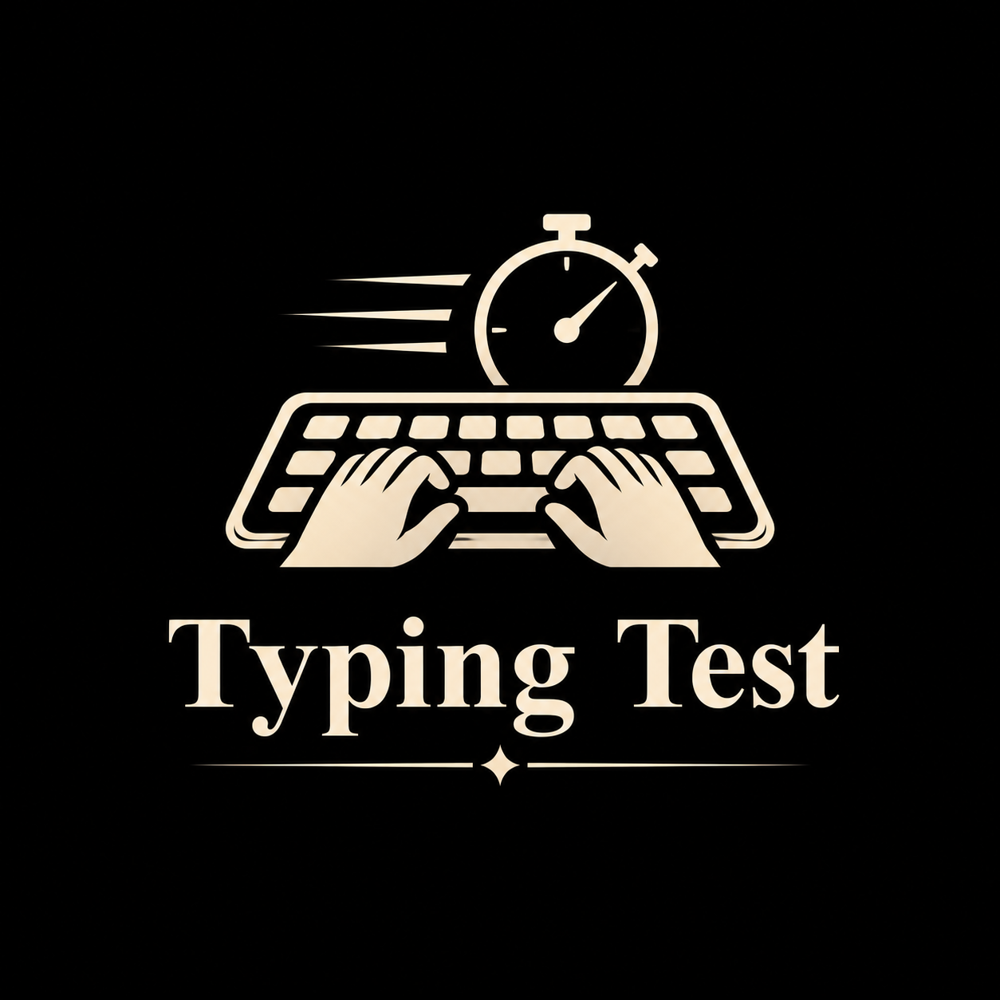

# Typing Test Indonesia

Aplikasi latihan kecepatan mengetik bahasa Indonesia. Berjalan offline, ringan, dan tersedia sebagai aplikasi Windows portable.



## Fitur

- Mode teks: kata, kalimat, dan paragraf.
- Tingkat kesulitan: mudah, sedang, dan sulit.
- Pilihan waktu: 15, 30, 60, atau 120 detik.
- Statistik hasil: WPM, akurasi, karakter benar, dan karakter salah.
- 30 cerpen bahasa Indonesia pada mode paragraf: 10 cerpen per tingkat kesulitan.
- Tema terang dan gelap.
- Font Playfair Display.
- Kelola teks sendiri: tambah, impor `.txt`, ekspor `.txt`, dan hapus.
- Data teks kustom tersimpan lokal di browser melalui `localStorage`.
- Aplikasi Electron terbuka fullscreen.
- Tidak membutuhkan koneksi internet setelah source/dependency tersedia.

## Menjalankan di Browser

Tidak membutuhkan Electron untuk mencoba antarmuka web.

```powershell
cd C:\Users\User\typing-test
python -m http.server 8080
```

Buka `http://localhost:8080` di browser.

## Menjalankan Aplikasi Desktop

Prasyarat: Node.js dan npm.

```powershell
cd C:\Users\User\typing-test
npm install
npm start
```

Aplikasi terbuka fullscreen secara otomatis.

## Membuat `.exe` Windows

```powershell
cd C:\Users\User\typing-test
npm install
npm run dist
```

Output:

```text
release\Typing-Test-Indonesia-1.0.0.exe
```

Folder `release/` dan file `.exe` tidak disimpan di Git karena ukuran binary melebihi batas file GitHub. Untuk membagikan aplikasi, unggah `.exe` melalui **GitHub Releases** atau gunakan artifact GitHub Actions.

## Format Teks Kustom

Satu baris dianggap sebagai satu teks. Contoh file `teks.txt`:

```text
Saya belajar mengetik setiap hari.
Latihan rutin meningkatkan kecepatan dan akurasi.
Mengetik dengan tenang membantu mengurangi kesalahan.
```

Impor melalui menu **Kelola Teks**. Teks kustom tersedia di aplikasi setelah diimpor.

## Shortcut

| Shortcut | Fungsi |
|---|---|
| `Ctrl+R` | Ulangi tes |
| `Esc` | Kembali ke beranda |
| `Ctrl+Q` | Keluar aplikasi |

## Struktur Utama

```text
index.html                 Antarmuka aplikasi
style.css                  Tampilan dan tema
app.js                     Logika tes mengetik
data/texts.js              Kumpulan teks bawaan
main.cjs                   Proses Electron
package.json               Script dan konfigurasi build
icon.png                   Logo aplikasi
PlayfairDisplay-*.ttf      Font aplikasi
```

## Teknologi

- HTML, CSS, JavaScript
- Electron
- electron-builder
- Service Worker untuk dukungan offline browser

## Lisensi

MIT License. Lihat [`LICENSE`](LICENSE).

## Dukungan

Dukung pengembangan melalui [Sociabuzz](https://sociabuzz.com/bgzs).

## Repository

[github.com/Bgzs89/Typing-test-Indonesia-offline](https://github.com/Bgzs89/Typing-test-Indonesia-offline)
